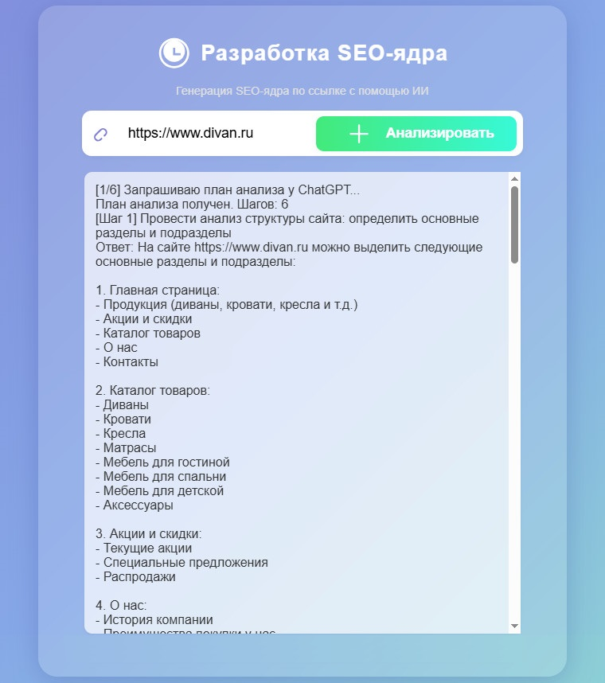
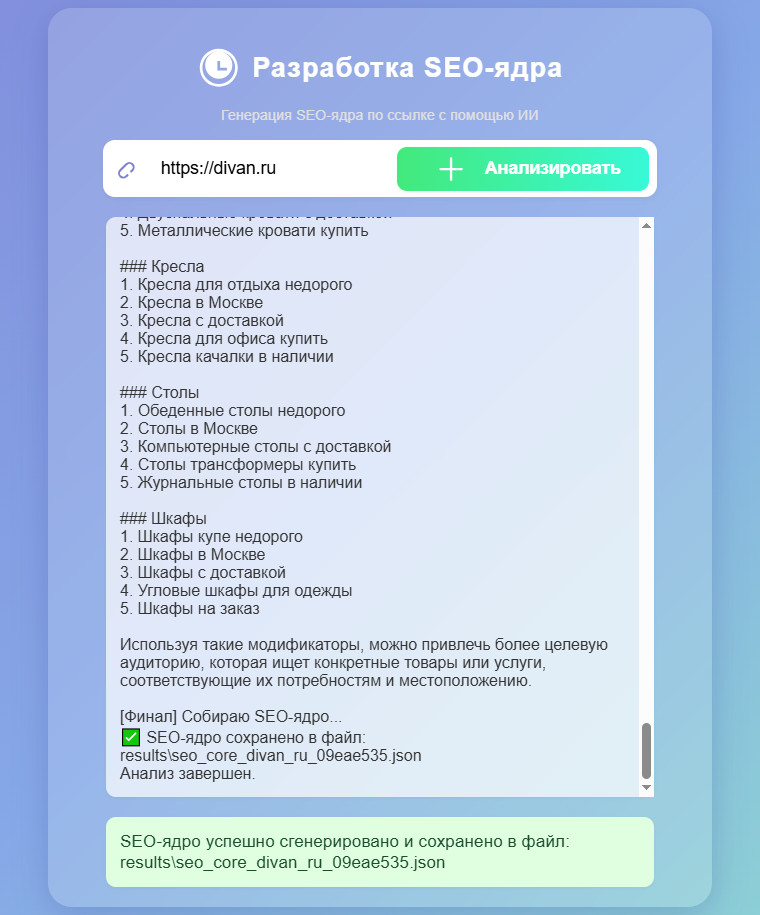

# AI-SEO-Core-Generator

Инструмент для генерации SEO-ядра по ссылке с помощью ИИ.  
Проект состоит из двух частей:

- **Backend (FastAPI)** — анализ сайта, парсинг, генерация запросов.
- **Frontend (Flask)** — веб-интерфейс, отображение логов и результата.

Приложение позволяет:
- анализировать структуру сайта;
- извлекать ключевые данные со страниц;
- генерировать SEO-ядро;
- выводить прогресс выполнения в режиме реального времени.

## 🧠 Как работает генерация SEO-ядра

1. Пользователь вводит URL  
2. Backend:
   - Загружает HTML страницы
   - Просит LLM сформировать **индивидуальный план анализа** (5–6 шагов)  
   - Выполняет каждый шаг (запрос → ответ), при необходимости подставляя исходный HTML  
   - На финальном этапе формирует структурированное SEO-ядро  
3. Frontend показывает live-лог выполнения и итоговый результат

✅ **Главное преимущество**: *адаптивный анализ*. Вместо жёсткого шаблона — LLM сам решает, какие шаги нужны для конкретного сайта.

**Стартовая страница**



**Результат работы**



## 📦 Структура проекта

```
AI-SEO-Core-Generator/
├── backend/
│   ├── main.py
│   ├── requirements.txt
│   └── Dockerfile
│
├── frontend/
│   ├── app.py
│   ├── requirements.txt
│   ├── Dockerfile
│   ├── templates/
│   │   └── index.html
│   └── static/
│       └── main.js
│
└── README.md
```


## 🚀 Установка и запуск (локально)

### 1. Клонирование репозитория
```bash
git clone https://github.com/USERNAME/AI-SEO-Core-Generator.git
cd AI-SEO-Core-Generator
```


## ▶️ Запуск Backend (FastAPI)

Перейти в папку backend:

```bash
cd backend
```

Установить зависимости:

```bash
pip install -r requirements.txt
```

Запустить:

```bash
uvicorn main:app --reload --port 9000
```

Backend будет доступен по адресу:

```
http://localhost:9000
```


## 🖥 Запуск Frontend (Flask)

Перейти в папку frontend:

```bash
cd ../frontend
```

Установить зависимости:

```bash
pip install -r requirements.txt
```

Запустить:

```bash
python app.py
```

Frontend будет доступен по адресу:

```
http://localhost:8000
```


## 🔗 Настройка соединения Frontend ↔ Backend

В файле `frontend/static/main.js` настрой адрес backend:

```javascript
const API_URL = "http://localhost:9000/analyze";
```

## 🧰 Используемые технологии

### Backend
- **FastAPI**
- **BeautifulSoup4**
- **httpx / requests**
- **pydantic**
- **uvicorn**

### Frontend
- **Flask**
- **HTML / CSS / JavaScript**
- **Fetch API**


## 🐳 Запуск через Docker (опционально)

```bash
docker build -t seo-backend ./backend
docker build -t seo-frontend ./frontend

docker run -p 9000:9000 seo-backend
docker run -p 8000:8000 seo-frontend
```

---

## 📝 Лицензия

MIT
